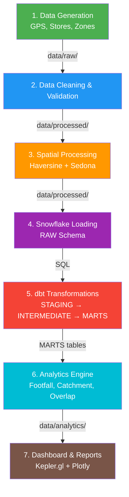
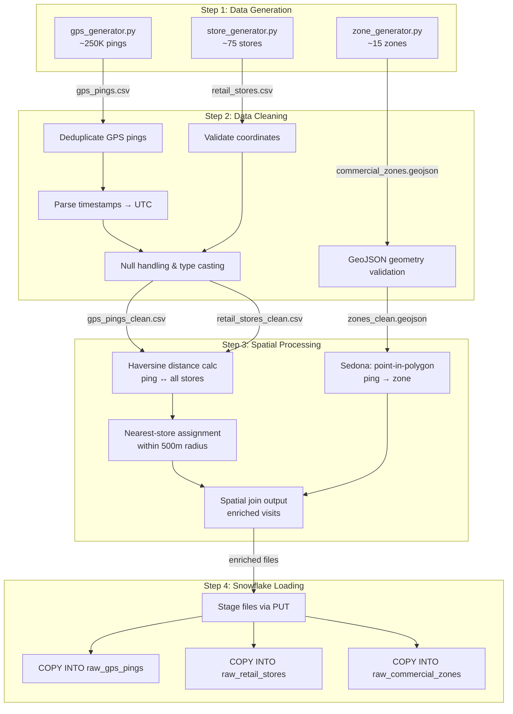
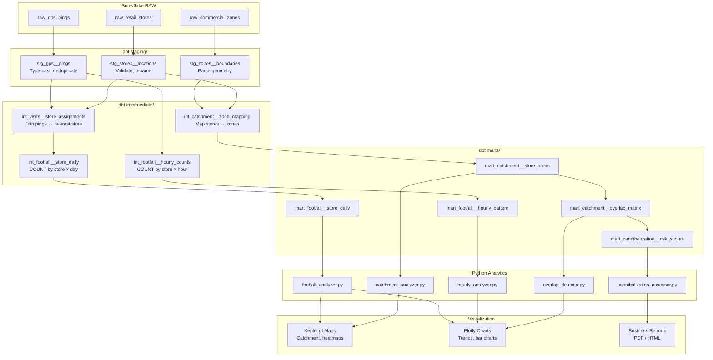
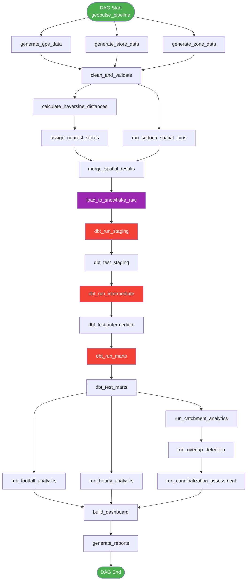
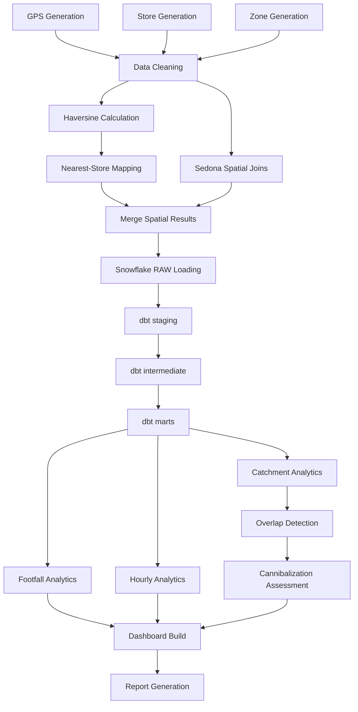

# GeoPulse — Data Flow Specification

> **Version:** 1.0  
> **Date:** 2026-11-15  
> **Status:** Day 2 — Architecture & Data Flow Design  

---

## 1. End-to-End Data Flow Description

The GeoPulse pipeline transforms **synthetic GPS mobility data** into **actionable retail analytics** through six sequential stages:

1. **Generation:** Python scripts produce ~250,000 synthetic GPS pings for ~5,000 simulated users moving through a metropolitan area over a configurable date range. Concurrently, ~75 retail store locations and ~15 commercial zone polygons are generated. All raw files land in `data/raw/`.

2. **Cleaning & Validation:** Raw datasets pass through the data quality layer. GPS pings are deduplicated, coordinates validated (latitude ∈ [−90, 90], longitude ∈ [−180, 180]), timestamps parsed and normalized to UTC, and null values handled. Stores are validated for unique IDs and valid coordinates. Zones are checked for valid GeoJSON polygon geometry. Cleaned outputs land in `data/processed/`.

3. **Spatial Enrichment:** The Haversine formula calculates the distance from each GPS ping to every store, and each ping is assigned to its nearest store (within a configurable radius threshold, e.g. 500 m). Apache Sedona performs spatial joins — point-in-polygon operations assign each ping to a commercial zone. The result is a spatially enriched visit dataset.

4. **Warehouse Loading:** Enriched datasets are loaded into Snowflake's `RAW` schema via staged file uploads (`PUT` + `COPY INTO`). This is the boundary where on-disk files transition to cloud-hosted SQL tables.

5. **dbt Transformation:** dbt models progressively transform data through `STAGING` (type-cast, rename), `INTERMEDIATE` (aggregate, join), and `MARTS` (business-ready) schemas. Mart tables contain store-level daily footfall, hourly footfall patterns, catchment area metrics, store overlap matrices, and cannibalization risk scores.

6. **Analytics & Visualization:** Python analytics scripts query the mart tables (or consume exported files) to produce business insights. Kepler.gl renders geospatial maps (store catchment areas, heatmaps of foot traffic). Plotly generates interactive charts (hourly footfall trends, cannibalization bar charts). Final outputs are saved to `reports/` and `dashboard/`.

---

## 2. Pipeline Flow Diagrams

### 2a. Overall Pipeline Flow — High-Level End-to-End



---

### 2b. Data Engineering Sub-flow

*Module 1 responsibility — from generation through to Snowflake RAW.*



---

### 2c. Analytics Sub-flow

*Module 2 responsibility — from Snowflake through dbt to dashboards.*



---

### 2d. Airflow Orchestration — DAG Structure

*Module 3 (shared) — task dependency graph within the Airflow DAG.*



---

## 3. Data Transformation Rules

### Stage-by-Stage Transformations

| Stage | Transformation Rules |
|---|---|
| **Raw → Cleaned** | • Remove exact-duplicate rows<br>• Validate latitude ∈ [−90, 90], longitude ∈ [−180, 180]; drop or flag out-of-bounds<br>• Parse `ping_timestamp` string → `datetime` (UTC)<br>• Fill missing `user_id` → drop row (no imputation for identifiers)<br>• Ensure `store_id` uniqueness<br>• Validate GeoJSON `type == "Polygon"` and ring closure |
| **Cleaned → Spatially Enriched** | • Compute Haversine distance (km) from each ping to each store<br>• Assign `nearest_store_id` = store with minimum distance where distance ≤ 0.5 km<br>• Pings with no store within threshold → `nearest_store_id = NULL` (excluded from footfall)<br>• Sedona spatial join: assign `zone_id` from polygon containment |
| **RAW → STAGING (dbt)** | • `CAST` all columns to proper types (`VARCHAR` → `FLOAT`, `TIMESTAMP`, `INTEGER`)<br>• Rename columns to snake_case convention<br>• Deduplicate via `ROW_NUMBER() OVER (PARTITION BY ping_id ORDER BY loaded_at DESC)`<br>• Add `_loaded_at` audit column |
| **STAGING → INTERMEDIATE (dbt)** | • `JOIN` pings with stores on `nearest_store_id`<br>• `GROUP BY store_id, DATE_TRUNC('day', visit_time)` → daily footfall<br>• `GROUP BY store_id, HOUR(visit_time)` → hourly footfall<br>• `JOIN` stores with zones on spatial containment |
| **INTERMEDIATE → MARTS (dbt)** | • Add store metadata (name, address, zone) to footfall tables<br>• Compute catchment area metrics (unique visitors, visit frequency, avg dwell proxy)<br>• Build pairwise overlap matrix: `shared_visitors / LEAST(visitors_a, visitors_b)`<br>• Calculate cannibalization score: weighted combination of overlap %, distance, zone co-location |

---

## 4. Data Volume Estimates

| Dataset | Estimated Volume | Row Size (approx.) | Storage (approx.) |
|---|---|---|---|
| **GPS Pings (raw)** | ~250,000 rows | ~100 bytes/row | ~25 MB |
| **Unique Users** | ~5,000 | — | — |
| **Retail Stores** | ~75 rows | ~200 bytes/row | <1 MB |
| **Commercial Zones** | ~15 rows | ~2 KB/row (GeoJSON) | <1 MB |
| **Cleaned GPS Pings** | ~237,500 (after ~5% drop) | ~120 bytes/row | ~28 MB |
| **Nearest-Store Assignments** | ~237,500 | ~140 bytes/row | ~33 MB |
| **Processed Visits** | ~50,000–100,000 | ~160 bytes/row | ~16 MB |
| **Store Daily Footfall (mart)** | ~75 stores × ~30 days = ~2,250 | ~80 bytes/row | <1 MB |
| **Hourly Footfall (mart)** | ~75 × 24 = ~1,800 | ~60 bytes/row | <1 MB |
| **Overlap Matrix** | ~75 × 75 / 2 = ~2,812 pairs | ~50 bytes/row | <1 MB |
| **Cannibalization Scores** | ~75 stores | ~100 bytes/row | <1 MB |

> [!NOTE]
> Total pipeline data footprint is well under 100 MB. Snowflake micro-partitioning and clustering are not critical at this scale but may be configured for demonstration purposes.

---

## 5. Processing Dependencies

The following dependency graph defines what must complete before what. Any violation causes pipeline failure.



### Critical Path

The longest sequential chain determines minimum pipeline runtime:

```
GPS Generation → Cleaning → Haversine → Nearest-Store → Merge → Snowflake Load
  → dbt staging → dbt intermediate → dbt marts → Catchment Analytics
  → Overlap Detection → Cannibalization Assessment → Dashboard → Report
```

### Parallelization Opportunities

| Step | Can Run In Parallel With |
|---|---|
| GPS Generation | Store Generation, Zone Generation |
| Haversine Calculation | Sedona Spatial Joins |
| Footfall Analytics | Hourly Analytics, Catchment Analytics |
| Kepler.gl Map Build | Plotly Chart Generation |

---

## 6. Error Handling Strategy

### Layer-by-Layer Error Handling

| Layer | Error Type | Handling Strategy | Recovery |
|---|---|---|---|
| **Data Generation** | Config errors (invalid params) | Raise `ValueError` with descriptive message; fail fast | Fix config and re-run |
| **Data Generation** | File I/O errors | Catch `IOError`; log and retry once; fail if persists | Check disk space/permissions |
| **Data Cleaning** | Invalid coordinates | Log warning with row index; drop row; track count in quality report | Review quality report; adjust generator if drop rate > 10% |
| **Data Cleaning** | Null identifiers (`user_id`, `store_id`) | Drop row; log to `data/logs/cleaning_dropped.csv` | Investigate generator |
| **Data Cleaning** | Timestamp parse failures | Attempt multiple formats (`ISO 8601`, `Unix epoch`); drop if all fail | Fix generator output format |
| **Spatial Processing** | No store within radius threshold | Set `nearest_store_id = NULL`; exclude from footfall counts | Adjust radius or store density |
| **Spatial Processing** | Sedona geometry errors | Catch `GeoException`; log invalid geometries; skip affected rows | Fix zone GeoJSON |
| **Snowflake Loading** | Connection failure | Retry with exponential backoff (3 attempts, 5s/15s/45s delay) | Check credentials in `.env` |
| **Snowflake Loading** | COPY INTO partial failure | Log rejected rows via Snowflake `VALIDATION_MODE`; load accepted rows | Review rejected row log |
| **dbt Transformation** | Test failure (schema, data) | dbt stops downstream models; Airflow task fails | Fix source data or model logic; `dbt retry` |
| **dbt Transformation** | Model compilation error | dbt exits with error code; Airflow marks task failed | Fix SQL / Jinja syntax |
| **Analytics** | Empty input data | Check row count before processing; raise `DataError` if zero | Verify upstream dbt models ran |
| **Analytics** | Division by zero (metrics) | Use safe division: `NULLIF(denominator, 0)` or `np.where` guards | Review metric formulas |
| **Dashboard** | Kepler.gl config mismatch | Validate config schema before render; fallback to default config | Regenerate config from data |
| **Airflow** | Task failure | Retry up to 2 times with 5-minute delay; alert on final failure | Check logs; fix and trigger task re-run |
| **Airflow** | DAG timeout | Set `dagrun_timeout`; alert on breach | Investigate bottleneck; optimize |

### Logging & Observability

- **Python scripts:** Use `logging` module with `INFO`/`WARNING`/`ERROR` levels. Log to both console and `data/logs/<script>_<date>.log`.
- **dbt:** Built-in logging to `dbt/logs/`. Use `dbt test` for data quality assertions.
- **Airflow:** Native task logs in Airflow UI. Configure email alerts on task failure.
- **Quality Reports:** Each pipeline run produces a `data/logs/quality_report.json` summarizing rows in, rows dropped, and drop reasons per stage.

### Circuit Breaker Pattern

If the data cleaning stage drops more than **15%** of GPS pings, the pipeline halts and raises an alert rather than propagating suspicious data downstream. This threshold is configurable via environment variable `GEOPULSE_MAX_DROP_RATE`.
