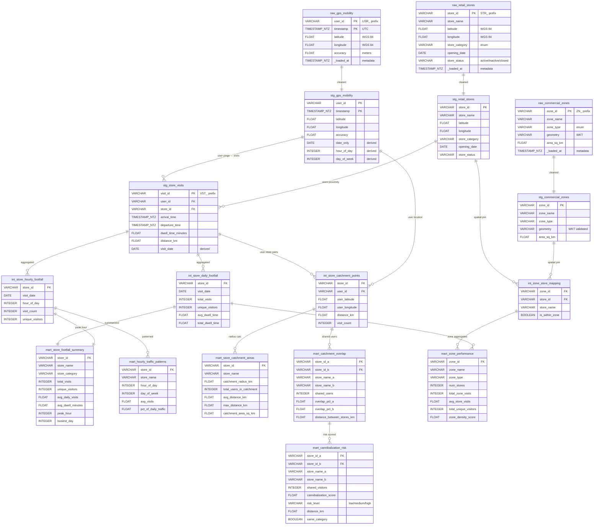

# GeoPulse — Database & Schema Design

> **Document**: Database Design Specification
> **Project**: GeoPulse — Hyper-Local Retail Mobility Analytics
> **Phase**: Day 3 — Database & Schema Design
> **Last Updated**: 2026-11-15
> **Status**: DRAFT — Do not connect to Snowflake

---

## Table of Contents

1. [Snowflake Database Structure](#1-snowflake-database-structure)
2. [RAW Schema Tables](#2-raw-schema-tables)
3. [STAGING Schema (dbt Models)](#3-staging-schema-dbt-models)
4. [INTERMEDIATE Schema (dbt Models)](#4-intermediate-schema-dbt-models)
5. [MARTS Schema (dbt Models)](#5-marts-schema-dbt-models)
6. [Entity-Relationship Diagram](#6-entity-relationship-diagram)
7. [Indexing Strategy](#7-indexing-strategy)
8. [Partitioning & Clustering](#8-partitioning--clustering)
9. [Schema-to-Source Mapping](#9-schema-to-source-mapping)

---

## 1. Snowflake Database Structure

| Component | Value | Notes |
|-----------|-------|-------|
| **Database** | `GEOPULSE_DB` | Single database for all project data |
| **Warehouse** | `GEOPULSE_WH` | X-Small (1 credit/hr); auto-suspend 300 s, auto-resume |
| **CRS** | WGS 84 (EPSG:4326) | All latitude/longitude values |
| **Timestamp Standard** | UTC, `TIMESTAMP_NTZ` | No time-zone conversion at storage layer |
| **ID Conventions** | Prefixed — `USR_`, `STR_`, `ZN_`, `VST_` | Human-readable, collision-safe |

### Schemas

| Schema | Purpose | Materialization | Owner |
|--------|---------|-----------------|-------|
| `RAW` | Unmodified ingested data from CSV/Parquet files | Tables (COPY INTO) | Module 1 (Data Engineering) |
| `STAGING` | Cleaned, typed, validated data; dbt `view`/`ephemeral` | dbt models | Module 2 (Analytics) |
| `INTERMEDIATE` | Business-logic aggregations & spatial joins | dbt models (`table`) | Module 2 (Analytics) |
| `MARTS` | Final analytics-ready tables for dashboards | dbt models (`table`) | Module 2 (Analytics) |

### Data Flow

```
CSV / Parquet  ──►  RAW  ──►  STAGING  ──►  INTERMEDIATE  ──►  MARTS  ──►  Dashboard
  (Module 1)       (COPY)     (dbt)          (dbt)              (dbt)      (Kepler.gl)
```

---

## 2. RAW Schema Tables

> [!NOTE]
> RAW tables receive data via `COPY INTO` from staged CSV/Parquet files.
> The `_loaded_at` column is populated automatically at load time.

### 2.1 `RAW.raw_gps_mobility`

Synthetic GPS pings representing user mobility events.

| # | Column | Snowflake Type | Nullable | Default | Constraints | Description |
|---|--------|---------------|----------|---------|-------------|-------------|
| 1 | `user_id` | `VARCHAR(50)` | **NO** | — | PK (composite) | Unique user identifier, prefixed `USR_` |
| 2 | `timestamp` | `TIMESTAMP_NTZ` | **NO** | — | PK (composite) | UTC timestamp of the GPS ping |
| 3 | `latitude` | `FLOAT` | **NO** | — | CHECK (-90 ≤ val ≤ 90) | WGS 84 latitude in decimal degrees |
| 4 | `longitude` | `FLOAT` | **NO** | — | CHECK (-180 ≤ val ≤ 180) | WGS 84 longitude in decimal degrees |
| 5 | `accuracy` | `FLOAT` | YES | — | CHECK (val > 0) | GPS accuracy radius in meters |
| 6 | `_loaded_at` | `TIMESTAMP_NTZ` | YES | `CURRENT_TIMESTAMP()` | — | Metadata: row load timestamp |

- **Primary Key**: `(user_id, timestamp)`
- **Expected Volume**: ~250,000 rows
- **Source**: Module 1 — Synthetic GPS Data Generation

---

### 2.2 `RAW.raw_retail_stores`

Retail store master data with geographic coordinates.

| # | Column | Snowflake Type | Nullable | Default | Constraints | Description |
|---|--------|---------------|----------|---------|-------------|-------------|
| 1 | `store_id` | `VARCHAR(50)` | **NO** | — | PK | Unique store identifier, prefixed `STR_` |
| 2 | `store_name` | `VARCHAR(255)` | **NO** | — | — | Human-readable store name |
| 3 | `latitude` | `FLOAT` | **NO** | — | CHECK (-90 ≤ val ≤ 90) | Store location latitude (WGS 84) |
| 4 | `longitude` | `FLOAT` | **NO** | — | CHECK (-180 ≤ val ≤ 180) | Store location longitude (WGS 84) |
| 5 | `store_category` | `VARCHAR(50)` | **NO** | — | — | Category enum (see data dictionary) |
| 6 | `opening_date` | `DATE` | YES | — | — | Date the store opened |
| 7 | `store_status` | `VARCHAR(20)` | **NO** | `'active'` | — | Operational status: active / inactive / closed |
| 8 | `_loaded_at` | `TIMESTAMP_NTZ` | YES | `CURRENT_TIMESTAMP()` | — | Metadata: row load timestamp |

- **Primary Key**: `store_id`
- **Expected Volume**: ~50–200 rows
- **Source**: Module 1 — Retail Store Data Generation

---

### 2.3 `RAW.raw_commercial_zones`

Commercial zone boundary definitions stored as WKT geometry strings.

| # | Column | Snowflake Type | Nullable | Default | Constraints | Description |
|---|--------|---------------|----------|---------|-------------|-------------|
| 1 | `zone_id` | `VARCHAR(50)` | **NO** | — | PK | Unique zone identifier, prefixed `ZN_` |
| 2 | `zone_name` | `VARCHAR(255)` | **NO** | — | — | Human-readable zone name |
| 3 | `zone_type` | `VARCHAR(50)` | **NO** | — | — | Zone type enum (see data dictionary) |
| 4 | `geometry` | `VARCHAR(16777216)` | **NO** | — | — | Zone boundary in WKT format (POLYGON/MULTIPOLYGON) |
| 5 | `area_sq_km` | `FLOAT` | **NO** | — | CHECK (val > 0) | Zone area in square kilometers |
| 6 | `_loaded_at` | `TIMESTAMP_NTZ` | YES | `CURRENT_TIMESTAMP()` | — | Metadata: row load timestamp |

- **Primary Key**: `zone_id`
- **Expected Volume**: ~10–50 rows
- **Source**: Module 2 — Commercial Zoning Data Prep

---

## 3. STAGING Schema (dbt Models)

> [!IMPORTANT]
> Staging models are owned by Module 2 (Analytics & Visualization) and implemented as dbt models.
> They clean, cast, and validate RAW data. Default materialization: `view`.

### 3.1 `STAGING.stg_gps_mobility`

Cleaned and enriched GPS mobility data with derived time dimensions.

| # | Column | Data Type | Nullable | Source / Derivation | Description |
|---|--------|-----------|----------|---------------------|-------------|
| 1 | `user_id` | `VARCHAR(50)` | NO | `raw_gps_mobility.user_id` | Trimmed & validated user ID |
| 2 | `timestamp` | `TIMESTAMP_NTZ` | NO | `raw_gps_mobility.timestamp` | UTC timestamp of GPS ping |
| 3 | `latitude` | `FLOAT` | NO | `raw_gps_mobility.latitude` | Validated latitude [-90, 90] |
| 4 | `longitude` | `FLOAT` | NO | `raw_gps_mobility.longitude` | Validated longitude [-180, 180] |
| 5 | `accuracy` | `FLOAT` | YES | `raw_gps_mobility.accuracy` | GPS accuracy in meters |
| 6 | `date_only` | `DATE` | NO | `CAST(timestamp AS DATE)` | Date extracted from timestamp |
| 7 | `hour_of_day` | `INTEGER` | NO | `EXTRACT(HOUR FROM timestamp)` | Hour (0–23) |
| 8 | `day_of_week` | `INTEGER` | NO | `DAYOFWEEK(timestamp)` | Day of week (0=Mon … 6=Sun) |
| 9 | `_loaded_at` | `TIMESTAMP_NTZ` | YES | `raw_gps_mobility._loaded_at` | Passthrough metadata |

- **dbt model**: `stg_gps_mobility.sql`
- **Source table**: `RAW.raw_gps_mobility`
- **Filters**: Exclude rows where latitude/longitude are out of valid range; exclude null `user_id`

---

### 3.2 `STAGING.stg_retail_stores`

Cleaned retail store dimension with validated coordinates.

| # | Column | Data Type | Nullable | Source / Derivation | Description |
|---|--------|-----------|----------|---------------------|-------------|
| 1 | `store_id` | `VARCHAR(50)` | NO | `raw_retail_stores.store_id` | Trimmed store ID |
| 2 | `store_name` | `VARCHAR(255)` | NO | `raw_retail_stores.store_name` | Trimmed store name |
| 3 | `latitude` | `FLOAT` | NO | `raw_retail_stores.latitude` | Validated latitude |
| 4 | `longitude` | `FLOAT` | NO | `raw_retail_stores.longitude` | Validated longitude |
| 5 | `store_category` | `VARCHAR(50)` | NO | `raw_retail_stores.store_category` | Lowered & trimmed category |
| 6 | `opening_date` | `DATE` | YES | `raw_retail_stores.opening_date` | Store opening date |
| 7 | `store_status` | `VARCHAR(20)` | NO | `raw_retail_stores.store_status` | Lowered & trimmed status |
| 8 | `_loaded_at` | `TIMESTAMP_NTZ` | YES | `raw_retail_stores._loaded_at` | Passthrough metadata |

- **dbt model**: `stg_retail_stores.sql`
- **Source table**: `RAW.raw_retail_stores`
- **Filters**: Exclude rows with invalid coordinates; validate `store_status` ∈ {active, inactive, closed}

---

### 3.3 `STAGING.stg_commercial_zones`

Commercial zones with parsed and validated WKT geometry.

| # | Column | Data Type | Nullable | Source / Derivation | Description |
|---|--------|-----------|----------|---------------------|-------------|
| 1 | `zone_id` | `VARCHAR(50)` | NO | `raw_commercial_zones.zone_id` | Trimmed zone ID |
| 2 | `zone_name` | `VARCHAR(255)` | NO | `raw_commercial_zones.zone_name` | Trimmed zone name |
| 3 | `zone_type` | `VARCHAR(50)` | NO | `raw_commercial_zones.zone_type` | Lowered & validated zone type |
| 4 | `geometry` | `VARCHAR(16777216)` | NO | `raw_commercial_zones.geometry` | WKT geometry string (validated) |
| 5 | `area_sq_km` | `FLOAT` | NO | `raw_commercial_zones.area_sq_km` | Zone area in km² |
| 6 | `_loaded_at` | `TIMESTAMP_NTZ` | YES | `raw_commercial_zones._loaded_at` | Passthrough metadata |

- **dbt model**: `stg_commercial_zones.sql`
- **Source table**: `RAW.raw_commercial_zones`
- **Filters**: Exclude rows with empty/invalid WKT geometry; validate `zone_type` enum values

---

### 3.4 `STAGING.stg_store_visits`

Derived visit events linking users to stores via proximity detection.

| # | Column | Data Type | Nullable | Source / Derivation | Description |
|---|--------|-----------|----------|---------------------|-------------|
| 1 | `visit_id` | `VARCHAR(100)` | NO | Generated (`VST_` prefix) | Unique visit identifier |
| 2 | `user_id` | `VARCHAR(50)` | NO | GPS proximity matching | User who visited |
| 3 | `store_id` | `VARCHAR(50)` | NO | Nearest-store assignment | Store visited |
| 4 | `arrival_time` | `TIMESTAMP_NTZ` | NO | First ping within proximity | Visit start time (UTC) |
| 5 | `departure_time` | `TIMESTAMP_NTZ` | NO | Last ping within proximity | Visit end time (UTC) |
| 6 | `dwell_time_minutes` | `FLOAT` | NO | `DATEDIFF(minute, arrival, departure)` | Time spent in store (minutes) |
| 7 | `distance_km` | `FLOAT` | NO | Haversine calculation | Distance from user to store (km) |
| 8 | `visit_date` | `DATE` | NO | `CAST(arrival_time AS DATE)` | Date of the visit |

- **dbt model**: `stg_store_visits.sql`
- **Source**: Module 1 processed visit data → loaded to RAW → cleaned in staging
- **Key handoff**: This is the primary interface between Module 1 (Data Engineering) and Module 2 (Analytics)

---

## 4. INTERMEDIATE Schema (dbt Models)

> [!NOTE]
> Intermediate models aggregate staging data into business-logic building blocks.
> Default materialization: `table` (for performance on downstream joins).

### 4.1 `INTERMEDIATE.int_store_daily_footfall`

Daily footfall metrics aggregated per store.

| # | Column | Data Type | Nullable | Source / Derivation | Description |
|---|--------|-----------|----------|---------------------|-------------|
| 1 | `store_id` | `VARCHAR(50)` | NO | `stg_store_visits.store_id` | Store identifier |
| 2 | `visit_date` | `DATE` | NO | `stg_store_visits.visit_date` | Date of visits |
| 3 | `total_visits` | `INTEGER` | NO | `COUNT(visit_id)` | Total visit count for the day |
| 4 | `unique_visitors` | `INTEGER` | NO | `COUNT(DISTINCT user_id)` | Distinct visitors for the day |
| 5 | `avg_dwell_time` | `FLOAT` | NO | `AVG(dwell_time_minutes)` | Average dwell time (minutes) |
| 6 | `total_dwell_time` | `FLOAT` | NO | `SUM(dwell_time_minutes)` | Total dwell time (minutes) |

- **dbt model**: `int_store_daily_footfall.sql`
- **Grain**: One row per `(store_id, visit_date)`
- **Source**: `STAGING.stg_store_visits`

---

### 4.2 `INTERMEDIATE.int_store_hourly_footfall`

Hourly footfall breakdown per store per day.

| # | Column | Data Type | Nullable | Source / Derivation | Description |
|---|--------|-----------|----------|---------------------|-------------|
| 1 | `store_id` | `VARCHAR(50)` | NO | `stg_store_visits.store_id` | Store identifier |
| 2 | `visit_date` | `DATE` | NO | `stg_store_visits.visit_date` | Date of visits |
| 3 | `hour_of_day` | `INTEGER` | NO | `EXTRACT(HOUR FROM arrival_time)` | Hour (0–23) |
| 4 | `visit_count` | `INTEGER` | NO | `COUNT(visit_id)` | Visits in that hour |
| 5 | `unique_visitors` | `INTEGER` | NO | `COUNT(DISTINCT user_id)` | Distinct visitors in that hour |

- **dbt model**: `int_store_hourly_footfall.sql`
- **Grain**: One row per `(store_id, visit_date, hour_of_day)`
- **Source**: `STAGING.stg_store_visits`

---

### 4.3 `INTERMEDIATE.int_store_catchment_points`

Individual user-to-store proximity records for catchment analysis.

| # | Column | Data Type | Nullable | Source / Derivation | Description |
|---|--------|-----------|----------|---------------------|-------------|
| 1 | `store_id` | `VARCHAR(50)` | NO | `stg_store_visits.store_id` | Store identifier |
| 2 | `user_id` | `VARCHAR(50)` | NO | `stg_store_visits.user_id` | User identifier |
| 3 | `user_latitude` | `FLOAT` | NO | `stg_gps_mobility.latitude` | User's representative latitude |
| 4 | `user_longitude` | `FLOAT` | NO | `stg_gps_mobility.longitude` | User's representative longitude |
| 5 | `distance_km` | `FLOAT` | NO | Haversine from user centroid to store | Distance in kilometers |
| 6 | `visit_count` | `INTEGER` | NO | `COUNT(visit_id)` per user-store | Number of visits by this user to this store |

- **dbt model**: `int_store_catchment_points.sql`
- **Grain**: One row per `(store_id, user_id)`
- **Source**: `STAGING.stg_store_visits` joined with `STAGING.stg_gps_mobility`

---

### 4.4 `INTERMEDIATE.int_zone_store_mapping`

Maps stores to the commercial zone they fall within.

| # | Column | Data Type | Nullable | Source / Derivation | Description |
|---|--------|-----------|----------|---------------------|-------------|
| 1 | `zone_id` | `VARCHAR(50)` | NO | `stg_commercial_zones.zone_id` | Zone identifier |
| 2 | `store_id` | `VARCHAR(50)` | NO | `stg_retail_stores.store_id` | Store identifier |
| 3 | `store_name` | `VARCHAR(255)` | NO | `stg_retail_stores.store_name` | Store name |
| 4 | `is_within_zone` | `BOOLEAN` | NO | Spatial containment check | Whether the store point falls inside the zone polygon |

- **dbt model**: `int_zone_store_mapping.sql`
- **Grain**: One row per `(zone_id, store_id)`
- **Source**: `STAGING.stg_retail_stores` × `STAGING.stg_commercial_zones` (spatial join)

---

## 5. MARTS Schema (dbt Models)

> [!IMPORTANT]
> Mart models are the final analytics-ready tables consumed by the Kepler.gl dashboard and business reports.
> Materialization: `table`. These are the primary deliverables of Module 2.

### 5.1 `MARTS.mart_store_footfall_summary`

Store-level lifetime footfall summary for executive reporting.

| # | Column | Data Type | Nullable | Description |
|---|--------|-----------|----------|-------------|
| 1 | `store_id` | `VARCHAR(50)` | NO | Store identifier |
| 2 | `store_name` | `VARCHAR(255)` | NO | Store name |
| 3 | `store_category` | `VARCHAR(50)` | NO | Store category |
| 4 | `total_visits` | `INTEGER` | NO | Lifetime total visits |
| 5 | `unique_visitors` | `INTEGER` | NO | Lifetime unique visitors |
| 6 | `avg_daily_visits` | `FLOAT` | NO | Average visits per day |
| 7 | `avg_dwell_minutes` | `FLOAT` | NO | Average dwell time in minutes |
| 8 | `peak_hour` | `INTEGER` | NO | Hour with highest traffic (0–23) |
| 9 | `busiest_day` | `INTEGER` | NO | Day of week with highest traffic |

- **Grain**: One row per `store_id`
- **Source**: `int_store_daily_footfall`, `int_store_hourly_footfall`, `stg_retail_stores`

---

### 5.2 `MARTS.mart_hourly_traffic_patterns`

Hourly traffic distribution for time-of-day analysis.

| # | Column | Data Type | Nullable | Description |
|---|--------|-----------|----------|-------------|
| 1 | `store_id` | `VARCHAR(50)` | NO | Store identifier |
| 2 | `store_name` | `VARCHAR(255)` | NO | Store name |
| 3 | `hour_of_day` | `INTEGER` | NO | Hour (0–23) |
| 4 | `day_of_week` | `INTEGER` | NO | Day of week (0=Mon … 6=Sun) |
| 5 | `avg_visits` | `FLOAT` | NO | Average visits for this hour/day combo |
| 6 | `pct_of_daily_traffic` | `FLOAT` | NO | This hour's share of total daily traffic (0–100) |

- **Grain**: One row per `(store_id, hour_of_day, day_of_week)`
- **Source**: `int_store_hourly_footfall`, `stg_retail_stores`

---

### 5.3 `MARTS.mart_store_catchment_areas`

Geographic catchment area summary per store.

| # | Column | Data Type | Nullable | Description |
|---|--------|-----------|----------|-------------|
| 1 | `store_id` | `VARCHAR(50)` | NO | Store identifier |
| 2 | `store_name` | `VARCHAR(255)` | NO | Store name |
| 3 | `catchment_radius_km` | `FLOAT` | NO | Effective catchment radius (e.g., 90th percentile distance) |
| 4 | `total_users_in_catchment` | `INTEGER` | NO | Count of unique users within catchment |
| 5 | `avg_distance_km` | `FLOAT` | NO | Mean user-to-store distance (km) |
| 6 | `max_distance_km` | `FLOAT` | NO | Max user-to-store distance (km) |
| 7 | `catchment_area_sq_km` | `FLOAT` | NO | Approximate catchment area (π × r²) |

- **Grain**: One row per `store_id`
- **Source**: `int_store_catchment_points`, `stg_retail_stores`

---

### 5.4 `MARTS.mart_catchment_overlap`

Pairwise store catchment overlap for geographic competition analysis.

| # | Column | Data Type | Nullable | Description |
|---|--------|-----------|----------|-------------|
| 1 | `store_id_a` | `VARCHAR(50)` | NO | First store in the pair |
| 2 | `store_id_b` | `VARCHAR(50)` | NO | Second store in the pair |
| 3 | `store_name_a` | `VARCHAR(255)` | NO | Name of store A |
| 4 | `store_name_b` | `VARCHAR(255)` | NO | Name of store B |
| 5 | `shared_users` | `INTEGER` | NO | Users visiting both stores |
| 6 | `overlap_pct_a` | `FLOAT` | NO | % of store A's users also visiting store B |
| 7 | `overlap_pct_b` | `FLOAT` | NO | % of store B's users also visiting store A |
| 8 | `distance_between_stores_km` | `FLOAT` | NO | Haversine distance between the two stores |

- **Grain**: One row per unique store pair `(store_id_a, store_id_b)` where `store_id_a < store_id_b`
- **Source**: `int_store_catchment_points`, `stg_retail_stores`

---

### 5.5 `MARTS.mart_cannibalization_risk`

Cannibalization risk scoring between store pairs.

| # | Column | Data Type | Nullable | Description |
|---|--------|-----------|----------|-------------|
| 1 | `store_id_a` | `VARCHAR(50)` | NO | First store in the pair |
| 2 | `store_id_b` | `VARCHAR(50)` | NO | Second store in the pair |
| 3 | `store_name_a` | `VARCHAR(255)` | NO | Name of store A |
| 4 | `store_name_b` | `VARCHAR(255)` | NO | Name of store B |
| 5 | `shared_visitors` | `INTEGER` | NO | Count of shared visitors |
| 6 | `cannibalization_score` | `FLOAT` | NO | Composite score (0.0–1.0) based on overlap, distance, category |
| 7 | `risk_level` | `VARCHAR(10)` | NO | Categorical risk: `low` / `medium` / `high` |
| 8 | `distance_km` | `FLOAT` | NO | Distance between stores (km) |
| 9 | `same_category` | `BOOLEAN` | NO | Whether both stores share the same `store_category` |

- **Grain**: One row per unique store pair `(store_id_a, store_id_b)` where `store_id_a < store_id_b`
- **Source**: `mart_catchment_overlap`, `stg_retail_stores`
- **Score Formula**: `cannibalization_score = w1 * overlap_pct + w2 * (1 / distance_km) + w3 * same_category_flag` (weights TBD during analytics phase)

---

### 5.6 `MARTS.mart_zone_performance`

Zone-level performance metrics for commercial area benchmarking.

| # | Column | Data Type | Nullable | Description |
|---|--------|-----------|----------|-------------|
| 1 | `zone_id` | `VARCHAR(50)` | NO | Zone identifier |
| 2 | `zone_name` | `VARCHAR(255)` | NO | Zone name |
| 3 | `zone_type` | `VARCHAR(50)` | NO | Zone type |
| 4 | `num_stores` | `INTEGER` | NO | Number of stores in the zone |
| 5 | `total_zone_visits` | `INTEGER` | NO | Sum of all store visits in the zone |
| 6 | `avg_store_visits` | `FLOAT` | NO | Average visits per store in the zone |
| 7 | `total_unique_visitors` | `INTEGER` | NO | Distinct visitors across all zone stores |
| 8 | `zone_density_score` | `FLOAT` | NO | `total_zone_visits / area_sq_km` — visits per km² |

- **Grain**: One row per `zone_id`
- **Source**: `int_zone_store_mapping`, `int_store_daily_footfall`, `stg_commercial_zones`

---

## 6. Entity-Relationship Diagram



---

## 7. Indexing Strategy

> [!TIP]
> Snowflake does not use traditional B-tree indexes. Instead, it relies on **micro-partitions** and **clustering keys** for query pruning. The recommendations below use Snowflake's clustering approach.

### Recommended Search Optimization

| Table | Columns for Search Optimization | Rationale |
|-------|--------------------------------|-----------|
| `raw_gps_mobility` | `user_id`, `timestamp` | Frequent filtering by user and time range |
| `stg_store_visits` | `store_id`, `visit_date` | Core join key for all downstream aggregations |
| `stg_store_visits` | `user_id` | User-centric catchment queries |
| `int_store_daily_footfall` | `store_id`, `visit_date` | Time-series queries on daily footfall |
| `int_store_hourly_footfall` | `store_id`, `visit_date`, `hour_of_day` | Hourly pattern analysis |
| `mart_catchment_overlap` | `store_id_a`, `store_id_b` | Pairwise lookup queries |

### Snowflake Search Optimization Service

For mart tables queried ad-hoc from the dashboard, enable **Search Optimization**:

```sql
ALTER TABLE MARTS.mart_store_footfall_summary ADD SEARCH OPTIMIZATION;
ALTER TABLE MARTS.mart_zone_performance ADD SEARCH OPTIMIZATION;
```

---

## 8. Partitioning & Clustering

> [!NOTE]
> Snowflake automatically partitions data into micro-partitions. **Clustering keys** guide the physical ordering within those partitions to improve query pruning.

### Recommended Clustering Keys

| Table | Clustering Key | Rationale |
|-------|---------------|-----------|
| `RAW.raw_gps_mobility` | `(timestamp, user_id)` | Time-range scans are the dominant access pattern |
| `STAGING.stg_store_visits` | `(visit_date, store_id)` | Most downstream queries filter by date then join on store |
| `INTERMEDIATE.int_store_daily_footfall` | `(visit_date)` | Time-series analysis |
| `INTERMEDIATE.int_store_hourly_footfall` | `(visit_date, hour_of_day)` | Time-series + hourly drill-down |
| `INTERMEDIATE.int_store_catchment_points` | `(store_id)` | Store-centric catchment aggregation |

### Example DDL

```sql
ALTER TABLE RAW.raw_gps_mobility CLUSTER BY (timestamp, user_id);
ALTER TABLE STAGING.stg_store_visits CLUSTER BY (visit_date, store_id);
```

> At the current data volume (~250K rows), clustering is optional and may be deferred until performance issues are observed.

---

## 9. Schema-to-Source Mapping

> [!IMPORTANT]
> The existing scaffold uses `src/` sub-modules, while this design introduces root-level schema concepts.
> Both structures coexist. This table documents the mapping.

| Scaffold Module | Proposed Schema | Responsibility | Owner |
|-----------------|----------------|----------------|-------|
| `src/data_generation/` | `RAW` schema (input) | Generates synthetic CSV → loaded to RAW | Module 1 |
| `src/data_quality/` | `RAW` → `STAGING` validation | Quality checks applied in staging models | Module 1 + Module 2 |
| `src/spatial_processing/` | `STAGING` → `INTERMEDIATE` spatial logic | Haversine, spatial joins (Sedona) | Module 1 |
| `src/analytics/` | `INTERMEDIATE` → `MARTS` | Footfall, catchment, cannibalization | Module 2 |
| `sql/snowflake/` | All schemas (DDL scripts) | Schema creation DDL | Shared |
| `dbt/` | `STAGING`, `INTERMEDIATE`, `MARTS` | dbt project with model SQL | Module 2 |

---

*End of Database Design Document*
