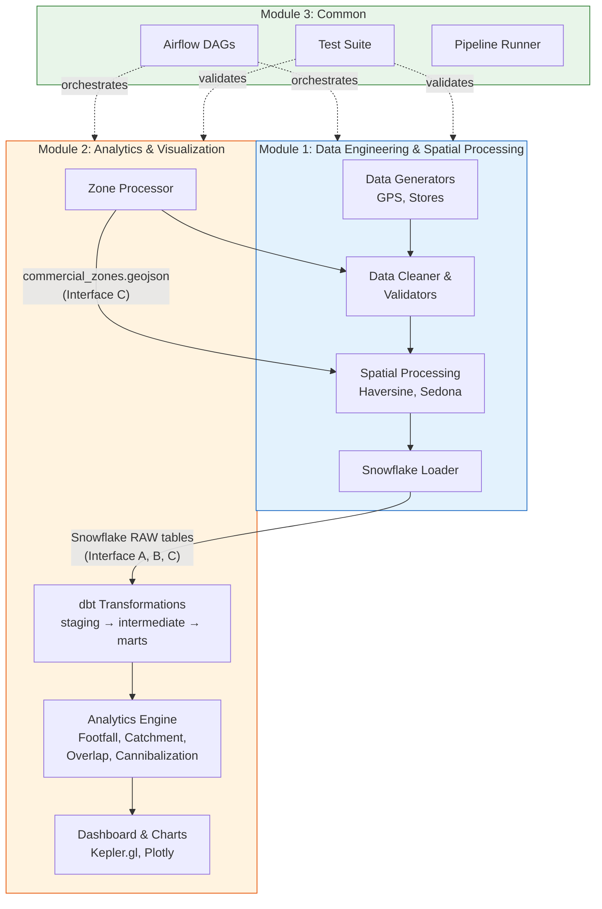

# GeoPulse — Module Design Specification

> **Version:** 1.0  
> **Date:** 2026-11-15  
> **Status:** Day 2 — Architecture & Data Flow Design  

---

## 1. Module 1: Data Engineering & Spatial Processing

**Owner:** Other team member  
**Scope:** Synthetic data generation, data cleaning/validation, Haversine distance calculation, nearest-store mapping, Apache Sedona spatial processing, spatial joins, and Snowflake data integration.

---

### 1.1 GPS Generator

| Attribute | Detail |
|---|---|
| **Purpose** | Generate ~250,000 synthetic GPS pings for ~5,000 simulated users with realistic mobility patterns across a metropolitan bounding box. |
| **Key Functions** | `generate_gps_pings(num_users, num_pings, bbox, date_range) → DataFrame` `add_noise(coords, sigma) → coords` (add Gaussian jitter) `save_gps_data(df, output_path) → None` |
| **Inputs** | Configuration: user count, ping count, bounding box `(lat_min, lat_max, lon_min, lon_max)`, date range |
| **Outputs** | `data/raw/gps_pings.csv` with columns: `ping_id, user_id, latitude, longitude, ping_timestamp` |
| **File Location** | `src/data_generation/gps_generator.py` |

### 1.2 Store Generator

| Attribute | Detail |
|---|---|
| **Purpose** | Generate ~75 synthetic retail store locations distributed across the target area. |
| **Key Functions** | `generate_stores(num_stores, bbox, zone_ids) → DataFrame` `save_store_data(df, output_path) → None` |
| **Inputs** | Configuration: store count, bounding box, zone identifiers |
| **Outputs** | `data/raw/retail_stores.csv` with columns: `store_id, store_name, latitude, longitude, zone_id, store_type, opening_date` |
| **File Location** | `src/data_generation/store_generator.py` |

### 1.3 Data Cleaner

| Attribute | Detail |
|---|---|
| **Purpose** | Clean and validate all raw datasets — remove duplicates, handle nulls, enforce coordinate bounds, normalize timestamps. |
| **Key Functions** | `clean_gps_data(df) → DataFrame` — dedup, coordinate validation, timestamp parsing `clean_store_data(df) → DataFrame` — dedup, coordinate validation, ID uniqueness `validate_geojson(geojson_path) → dict` — geometry validation |
| **Inputs** | Raw CSV/GeoJSON files from `data/raw/` |
| **Outputs** | Cleaned files in `data/processed/`: `gps_pings_clean.csv`, `retail_stores_clean.csv`, `commercial_zones_clean.geojson` |
| **File Location** | `src/data_quality/data_cleaner.py`, `src/data_quality/validators.py` |

### 1.4 Haversine Calculator

| Attribute | Detail |
|---|---|
| **Purpose** | Compute great-circle distances between GPS pings and retail stores using the Haversine formula. |
| **Key Functions** | `haversine_distance(lat1, lon1, lat2, lon2) → float` (in km) `compute_distance_matrix(pings_df, stores_df) → DataFrame` — cross-join distances |
| **Inputs** | Cleaned GPS pings DataFrame, cleaned stores DataFrame |
| **Outputs** | Distance matrix or enriched DataFrame with `distance_km` column |
| **File Location** | `src/spatial_processing/haversine_calculator.py` |

### 1.5 Nearest-Store Mapper

| Attribute | Detail |
|---|---|
| **Purpose** | Assign each GPS ping to its nearest retail store (within a configurable radius threshold). |
| **Key Functions** | `assign_nearest_store(pings_df, stores_df, max_distance_km=0.5) → DataFrame` `filter_unmatched(df) → tuple[DataFrame, DataFrame]` — split matched/unmatched |
| **Inputs** | Cleaned GPS pings, cleaned stores, distance threshold |
| **Outputs** | `data/processed/gps_with_nearest_store.csv` with added columns: `nearest_store_id, distance_to_store_km` |
| **File Location** | `src/spatial_processing/nearest_store_mapper.py` |

### 1.6 Sedona Processor

| Attribute | Detail |
|---|---|
| **Purpose** | Use Apache Sedona for point-in-polygon spatial joins to assign GPS pings to commercial zones. |
| **Key Functions** | `init_sedona_session() → SparkSession` `spatial_join_pings_to_zones(pings_df, zones_gdf) → DataFrame` `create_geometry_columns(df, lat_col, lon_col) → GeoDataFrame` |
| **Inputs** | Cleaned GPS pings (with nearest-store assignments), cleaned zones GeoJSON |
| **Outputs** | `data/processed/spatial_joins.parquet` with added column: `zone_id` |
| **File Location** | `src/spatial_processing/sedona_processor.py`, `src/spatial_processing/spatial_joins.py` |

### 1.7 Snowflake Loader

| Attribute | Detail |
|---|---|
| **Purpose** | Load processed datasets into Snowflake `GEOPULSE.RAW` schema tables. |
| **Key Functions** | `get_snowflake_connection() → Connection` `stage_and_load(file_path, table_name, schema='RAW') → int` (rows loaded) `verify_load(table_name) → dict` (row count, sample) |
| **Inputs** | Processed CSV/Parquet files from `data/processed/` |
| **Outputs** | Populated Snowflake tables: `raw_gps_pings`, `raw_retail_stores`, `raw_commercial_zones` |
| **File Location** | `src/data_generation/snowflake_loader.py` *(or `data_engineering/snowflake_loader.py`)* |

---

## 2. Module 2: Analytics & Visualization

**Owner:** You  
**Scope:** Commercial zoning data prep, store-level footfall analytics, hourly footfall analytics, dbt transformation models, store catchment analysis, geographic catchment overlap analysis, cannibalization risk assessment, Kepler.gl dashboard, and business insights.

---

### 2.1 Commercial Zone Processor

| Attribute | Detail |
|---|---|
| **Purpose** | Prepare and manage commercial zone boundary data — define zone polygons, assign zone metadata, and produce the zones dataset for downstream use. |
| **Key Functions** | `load_zone_definitions(config_path) → GeoDataFrame` `generate_zone_polygons(zone_specs) → GeoDataFrame` `enrich_zone_metadata(zones_gdf, attributes) → GeoDataFrame` `export_zones(zones_gdf, output_path) → None` |
| **Inputs** | Zone configuration (bounding boxes, names, categories) |
| **Outputs** | `data/raw/commercial_zones.geojson` with properties: `zone_id, zone_name, zone_type, area_sqkm` |
| **File Location** | `src/analytics/zone_processor.py` |

### 2.2 Footfall Analyzer

| Attribute | Detail |
|---|---|
| **Purpose** | Compute store-level footfall metrics: daily unique visitors, total visits, average visits per user, peak days. |
| **Key Functions** | `compute_store_daily_footfall(visits_df) → DataFrame` `compute_store_summary(daily_df) → DataFrame` — avg/min/max/std per store `rank_stores_by_footfall(summary_df) → DataFrame` |
| **Inputs** | `mart_footfall__store_daily` table (from Snowflake or exported CSV) |
| **Outputs** | `data/analytics/store_footfall.csv` with columns: `store_id, store_name, date, unique_visitors, total_visits, avg_visits_per_user` |
| **File Location** | `src/analytics/footfall_analyzer.py` |

### 2.3 Hourly Analyzer

| Attribute | Detail |
|---|---|
| **Purpose** | Analyze hourly footfall patterns to identify peak hours, off-peak hours, and time-based trends per store and across all stores. |
| **Key Functions** | `compute_hourly_profile(visits_df) → DataFrame` `identify_peak_hours(hourly_df, top_n=3) → DataFrame` `compute_hourly_heatmap(hourly_df) → DataFrame` — store × hour matrix |
| **Inputs** | `mart_footfall__hourly_pattern` table |
| **Outputs** | `data/analytics/hourly_footfall.csv` with columns: `store_id, hour_of_day, avg_visitors, pct_of_daily_total, is_peak` |
| **File Location** | `src/analytics/hourly_analyzer.py` |

### 2.4 Catchment Analyzer

| Attribute | Detail |
|---|---|
| **Purpose** | Define and measure store catchment areas — the geographic region from which a store draws its visitors. |
| **Key Functions** | `compute_catchment_area(visits_df, stores_df, method='convex_hull') → GeoDataFrame` `compute_catchment_radius(visits_df, percentile=90) → DataFrame` — 90th percentile distance `compute_catchment_metrics(catchment_gdf) → DataFrame` — area, visitor density |
| **Inputs** | Visit data with coordinates, store locations |
| **Outputs** | `data/analytics/catchment_areas.geojson` with properties: `store_id, catchment_area_sqkm, unique_visitors, visitor_density` |
| **File Location** | `src/analytics/catchment_analyzer.py` |

### 2.5 Overlap Detector

| Attribute | Detail |
|---|---|
| **Purpose** | Detect geographic overlap between store catchment areas — identify stores whose catchments intersect and quantify shared visitor pools. |
| **Key Functions** | `compute_pairwise_overlap(catchment_gdf) → DataFrame` `compute_shared_visitors(visits_df, store_a, store_b) → dict` `build_overlap_matrix(catchment_gdf, visits_df) → DataFrame` — full n×n matrix |
| **Inputs** | Catchment area GeoDataFrame, visit-level data |
| **Outputs** | `data/analytics/overlap_matrix.csv` with columns: `store_id_a, store_id_b, overlap_area_sqkm, overlap_pct, shared_visitors, shared_visitor_pct` |
| **File Location** | `src/analytics/overlap_detector.py` |

### 2.6 Cannibalization Assessor

| Attribute | Detail |
|---|---|
| **Purpose** | Score the cannibalization risk between pairs of stores based on catchment overlap, shared visitors, proximity, and zone co-location. |
| **Key Functions** | `compute_cannibalization_score(overlap_df, distance_df, zone_df, weights=None) → DataFrame` `classify_risk(score) → str` — "High" / "Medium" / "Low" `generate_recommendations(risk_df) → DataFrame` — actionable suggestions |
| **Inputs** | Overlap matrix, store distance matrix, zone assignments |
| **Outputs** | `data/analytics/cannibalization_scores.csv` with columns: `store_id_a, store_id_b, overlap_score, proximity_score, zone_score, composite_score, risk_level, recommendation` |
| **File Location** | `src/analytics/cannibalization_assessor.py` |

**Cannibalization Scoring Formula:**

$$\text{composite\_score} = w_1 \times \text{overlap\_pct} + w_2 \times (1 - \text{normalized\_distance}) + w_3 \times \text{same\_zone\_flag}$$

Default weights: $w_1 = 0.5$, $w_2 = 0.3$, $w_3 = 0.2$

| Composite Score | Risk Level |
|---|---|
| ≥ 0.7 | High |
| 0.4 – 0.69 | Medium |
| < 0.4 | Low |

### 2.7 Dashboard Builder (Kepler.gl)

| Attribute | Detail |
|---|---|
| **Purpose** | Build interactive geospatial maps showing store locations, catchment areas, foot-traffic heatmaps, and overlap regions using Kepler.gl. |
| **Key Functions** | `create_kepler_map(config_path=None) → KeplerGl` `add_store_layer(kmap, stores_df) → None` `add_catchment_layer(kmap, catchment_gdf) → None` `add_heatmap_layer(kmap, pings_df) → None` `export_map(kmap, output_path) → None` |
| **Inputs** | Store locations, catchment GeoDataFrame, GPS pings, analytics results |
| **Outputs** | `dashboard/kepler_config.json`, `dashboard/geopulse_map.html` |
| **File Location** | `dashboard/kepler_dashboard.py` |

### 2.8 Chart Generator (Plotly)

| Attribute | Detail |
|---|---|
| **Purpose** | Generate interactive Plotly charts for business insights: footfall trends, hourly patterns, overlap comparisons, cannibalization risk matrix. |
| **Key Functions** | `plot_footfall_trend(footfall_df, store_ids=None) → Figure` `plot_hourly_heatmap(hourly_df) → Figure` `plot_overlap_heatmap(overlap_matrix_df) → Figure` `plot_cannibalization_bar(risk_df) → Figure` `export_charts(figures, output_dir) → list[str]` |
| **Inputs** | Analytics output DataFrames |
| **Outputs** | Interactive HTML charts in `dashboard/charts/`, static PNGs in `reports/figures/` |
| **File Location** | `dashboard/chart_generator.py` |

---

## 3. Module 3: Common (Shared)

**Owner:** Both team members  
**Scope:** Apache Airflow DAGs, pipeline integration, E2E testing, documentation, final report, and presentation.

---

### 3.1 Airflow DAGs

| Attribute | Detail |
|---|---|
| **Purpose** | Orchestrate the entire GeoPulse pipeline as a directed acyclic graph with task dependencies, retries, and alerting. |
| **Key DAGs** | `geopulse_pipeline_dag` — full end-to-end pipeline `dbt_dag` — dbt-specific run & test cycle |
| **File Location** | `airflow/dags/geopulse_pipeline_dag.py`, `airflow/dags/dbt_dag.py` |

### 3.2 Pipeline Integrator

| Attribute | Detail |
|---|---|
| **Purpose** | Provide a standalone script to run the entire pipeline sequentially (without Airflow) for development and testing. |
| **Key Functions** | `run_pipeline(config) → dict` — returns success/failure status per step `run_step(step_name, func, *args) → bool` — run with logging and error handling |
| **File Location** | `src/pipeline_runner.py` |

### 3.3 Test Suite

| Attribute | Detail |
|---|---|
| **Purpose** | Comprehensive pytest test suite covering unit tests, integration tests, and end-to-end tests. |
| **Key Test Files** | `tests/test_project_scaffold.py` — *(existing)* directory structure tests `tests/test_data_generation.py` — generator output shape/types `tests/test_data_quality.py` — cleaning logic edge cases `tests/test_spatial_processing.py` — Haversine accuracy, nearest-store logic `tests/test_analytics.py` — footfall, catchment, overlap calculations `tests/test_pipeline_e2e.py` — full pipeline smoke test |
| **File Location** | `tests/` |

---

## 4. Inter-Module Interfaces

This section defines the **exact data contracts** between Module 1 and Module 2. These schemas are the agreed-upon API between the two team members.

### 4.1 Interface A: GPS Pings with Nearest Store

*Produced by: Module 1 → Consumed by: Module 2 (via Snowflake RAW)*

**File:** `data/processed/gps_with_nearest_store.csv`  
**Snowflake Table:** `GEOPULSE.RAW.raw_gps_pings`

| Column | Type | Nullable | Description |
|---|---|---|---|
| `ping_id` | `STRING` | No | Unique identifier for each GPS ping |
| `user_id` | `STRING` | No | Anonymous user identifier |
| `latitude` | `FLOAT` | No | GPS latitude (WGS84) |
| `longitude` | `FLOAT` | No | GPS longitude (WGS84) |
| `ping_timestamp` | `TIMESTAMP` | No | UTC timestamp of the ping |
| `nearest_store_id` | `STRING` | Yes | ID of nearest store (NULL if none within threshold) |
| `distance_to_store_km` | `FLOAT` | Yes | Distance to nearest store in km |
| `zone_id` | `STRING` | Yes | Commercial zone containing this point |

### 4.2 Interface B: Retail Stores

*Produced by: Module 1 → Consumed by: Module 2 (via Snowflake RAW)*

**File:** `data/processed/retail_stores_clean.csv`  
**Snowflake Table:** `GEOPULSE.RAW.raw_retail_stores`

| Column | Type | Nullable | Description |
|---|---|---|---|
| `store_id` | `STRING` | No | Unique store identifier |
| `store_name` | `STRING` | No | Human-readable store name |
| `latitude` | `FLOAT` | No | Store latitude (WGS84) |
| `longitude` | `FLOAT` | No | Store longitude (WGS84) |
| `zone_id` | `STRING` | No | Commercial zone the store belongs to |
| `store_type` | `STRING` | No | Category (e.g., "grocery", "electronics", "clothing") |
| `opening_date` | `DATE` | Yes | Date the store opened |

### 4.3 Interface C: Commercial Zones

*Produced by: Module 2 (zone prep) → Consumed by: Module 1 (spatial joins) & Module 2 (analytics)*

**File:** `data/raw/commercial_zones.geojson` (cleaned: `data/processed/commercial_zones_clean.geojson`)  
**Snowflake Table:** `GEOPULSE.RAW.raw_commercial_zones`

| Property | Type | Nullable | Description |
|---|---|---|---|
| `zone_id` | `STRING` | No | Unique zone identifier |
| `zone_name` | `STRING` | No | Human-readable zone name |
| `zone_type` | `STRING` | No | Zone category (e.g., "downtown", "suburban", "mall") |
| `area_sqkm` | `FLOAT` | No | Area of the zone in square km |
| `geometry` | `POLYGON` | No | GeoJSON polygon geometry |

### 4.4 Interface D: Visit Records (Intermediate)

*Produced by: Module 1 → Consumed by: Module 2*

This is the **post-spatial-processing** enriched dataset that captures a "visit" event — a GPS ping that was successfully matched to a store.

**File:** `data/processed/visits.csv`

| Column | Type | Nullable | Description |
|---|---|---|---|
| `visit_id` | `STRING` | No | Unique visit identifier (`ping_id` for matched pings) |
| `user_id` | `STRING` | No | Anonymous user identifier |
| `store_id` | `STRING` | No | Matched store identifier |
| `store_name` | `STRING` | No | Store name (denormalized) |
| `latitude` | `FLOAT` | No | Ping latitude |
| `longitude` | `FLOAT` | No | Ping longitude |
| `visit_timestamp` | `TIMESTAMP` | No | UTC timestamp |
| `distance_km` | `FLOAT` | No | Distance to matched store (km) |
| `zone_id` | `STRING` | Yes | Zone containing the ping |

---

## 5. Module Interaction Diagram

### Handoff Summary

| From | To | Interface | Trigger |
|---|---|---|---|
| Module 2 (Zone Processor) | Module 1 (Spatial Processing) | Interface C: `commercial_zones.geojson` | Zones must be generated before spatial joins |
| Module 1 (Snowflake Loader) | Module 2 (dbt) | Interfaces A, B, C: Snowflake RAW tables | RAW tables loaded → dbt staging begins |
| Module 1 (Spatial Processing) | Module 2 (Analytics) | Interface D: `visits.csv` | Direct file handoff for local dev (bypassing Snowflake) |
| Module 2 (Analytics) | Module 3 (Tests) | Analytics output files in `data/analytics/` | Test suite validates analytics outputs |
| Module 3 (Airflow) | Modules 1 & 2 | DAG task invocations | Scheduled or manual DAG trigger |

> [!IMPORTANT]
> The **Zone Processor** (Module 2) is a dependency for Module 1's spatial processing. This is the only case where Module 2 feeds Module 1. The zone data must be generated and placed in `data/raw/` before Module 1 runs spatial joins.

---

## 6. File Location Summary

| Component | Primary Path | Module |
|---|---|---|
| GPS Generator | `src/data_generation/gps_generator.py` | 1 |
| Store Generator | `src/data_generation/store_generator.py` | 1 |
| Zone Processor | `src/analytics/zone_processor.py` | 2 |
| Data Cleaner | `src/data_quality/data_cleaner.py` | 1 |
| Validators | `src/data_quality/validators.py` | 1 |
| Haversine Calculator | `src/spatial_processing/haversine_calculator.py` | 1 |
| Nearest-Store Mapper | `src/spatial_processing/nearest_store_mapper.py` | 1 |
| Sedona Processor | `src/spatial_processing/sedona_processor.py` | 1 |
| Spatial Joins | `src/spatial_processing/spatial_joins.py` | 1 |
| Snowflake Loader | `src/data_generation/snowflake_loader.py` | 1 |
| dbt Models | `dbt/models/staging/`, `intermediate/`, `marts/` | 2 |
| Footfall Analyzer | `src/analytics/footfall_analyzer.py` | 2 |
| Hourly Analyzer | `src/analytics/hourly_analyzer.py` | 2 |
| Catchment Analyzer | `src/analytics/catchment_analyzer.py` | 2 |
| Overlap Detector | `src/analytics/overlap_detector.py` | 2 |
| Cannibalization Assessor | `src/analytics/cannibalization_assessor.py` | 2 |
| Kepler.gl Dashboard | `dashboard/kepler_dashboard.py` | 2 |
| Chart Generator | `dashboard/chart_generator.py` | 2 |
| Airflow DAGs | `airflow/dags/` | 3 |
| Pipeline Runner | `src/pipeline_runner.py` | 3 |
| Tests | `tests/` | 3 |
