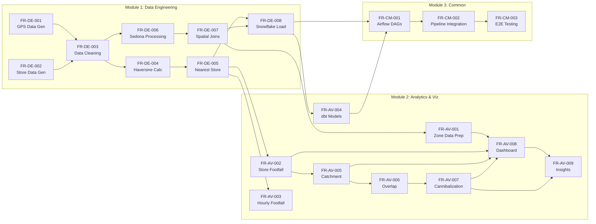

# GeoPulse — Scope & Constraints

**Version:** 1.0  
**Date:** November 15, 2026  
**Status:** Draft  

---

## 1. In-Scope

The following deliverables and capabilities are within the scope of the GeoPulse project:

### Module 1: Data Engineering & Spatial Processing
| Item | Description |
|---|---|
| Synthetic GPS data generation | Algorithmically generated GPS mobility pings (configurable volume, default 250K) |
| Synthetic retail store generation | Generated store locations with attributes (type, zone, hours) |
| Data cleaning & validation | Coordinate range checks, timestamp validation, deduplication, null handling |
| Haversine distance calculation | Great-circle distance between each GPS ping and store locations |
| Nearest-store mapping | Assignment of each ping to the geographically closest store |
| Apache Sedona spatial processing | Spatial indexing, buffering, and range queries using Sedona |
| Spatial joins | Point-in-polygon joins between GPS pings, commercial zones, and catchments |
| Snowflake data integration | Schema creation, staged loading, and validation of processed data in Snowflake |

### Module 2: Analytics & Visualization
| Item | Description |
|---|---|
| Commercial zoning data preparation | Zone polygon preparation, area computation, store-count enrichment |
| Store-level footfall analytics | Aggregate visit counts, daily averages, and footfall ranking per store |
| Hourly footfall analytics | Intra-day traffic pattern analysis with heatmap visualizations |
| dbt transformation models | Staging → intermediate → mart layer models with schema tests |
| Store catchment analysis | Catchment area delineation (radius-based, convex hull) per store |
| Geographic catchment overlap analysis | Quantified area and traffic overlap between neighboring catchments |
| Cannibalization risk assessment | Composite risk score (0–100) and classification (Low/Medium/High) |
| Kepler.gl interactive dashboard | Multi-layer geospatial dashboard (pings, stores, catchments, risk) |
| Business insights & recommendations | Data-driven report with expansion and mitigation strategies |

### Module 3: Common / Integration
| Item | Description |
|---|---|
| Apache Airflow DAGs | Pipeline orchestration from generation through dashboard output |
| Pipeline integration | End-to-end workflow connecting Module 1 outputs to Module 2 inputs |
| End-to-end testing | Automated test suite covering the full pipeline with small test data |
| Documentation | Requirements, architecture, data dictionary, setup guides, runbooks |
| Final project report | Comprehensive report covering objectives, methodology, results |
| Final presentation | Slide deck with live/recorded dashboard demo |

### Cross-Cutting
| Item | Description |
|---|---|
| Synthetic-only data | All data is generated; no real-world data acquisition required |
| Git/GitHub version control | Branching, PRs, code review, collaborative workflow |
| `.env`-based configuration | All environment-specific settings externalized |

---

## 2. Out-of-Scope

The following items are explicitly **excluded** from the GeoPulse project:

| Excluded Item | Rationale |
|---|---|
| **Real-time streaming ingestion** | Project uses batch-processed synthetic data; streaming (Kafka, Pub/Sub) adds unnecessary complexity for the academic scope. |
| **Mobile application** | No user-facing mobile app; all visualization is via browser-based Kepler.gl dashboard. |
| **ML-based prediction models** | No machine learning for footfall forecasting, demand prediction, or site scoring. The project focuses on descriptive and diagnostic analytics. |
| **Production deployment** | No cloud-hosted production environment; the pipeline runs locally or on Snowflake free trial. No CI/CD, load balancing, or auto-scaling. |
| **Multi-city / multi-region analysis** | Data generation and analytics are scoped to a single geographic bounding box (one city). Multi-city comparison is a future extension. |
| **Real GPS data acquisition** | No integration with GPS data providers (SafeGraph, Placer.ai, Foursquare). All data is synthetic. |
| **User authentication / RBAC** | The dashboard is a static HTML file with no login or role-based access. |
| **Automated alerting / monitoring** | No alerting for pipeline failures beyond Airflow's built-in UI. No PagerDuty / Slack integration. |
| **Competitor proximity analysis** | Only own-chain stores are modeled; no competitor store dataset is generated. |
| **Revenue / transaction modeling** | No POS data or revenue attribution. Footfall is measured by GPS ping proximity, not purchases. |

---

## 3. Constraints

### 3.1 Data Constraints

| Constraint | Impact |
|---|---|
| **Synthetic data only** | All GPS pings, store locations, and zone boundaries are algorithmically generated. Results demonstrate methodology, not real-world findings. Insights are illustrative, not actionable for a real retailer. |
| **No real-world validation** | Without real ground-truth data, model accuracy (catchment, cannibalization) cannot be externally validated. Correctness is verified through internal consistency checks and unit tests. |
| **Single bounding box** | Data generation is confined to a single rectangular geographic area. Edge effects near the boundary may skew catchment and overlap metrics for peripheral stores. |

### 3.2 Timeline Constraints

| Constraint | Detail |
|---|---|
| **Academic timeline** | The project must be completed within the November – December 2026 academic term. |
| **Phase 1 deadline** | Planning and requirements documentation must be finalized by November 18, 2026 (4 days). |
| **Implementation window** | Core implementation (Phases 2–4) spans approximately 4–5 weeks after Phase 1. |
| **Presentation deadline** | Final presentation and report must be delivered by the end of the academic term (mid-December 2026). |

### 3.3 Team Constraints

| Constraint | Detail |
|---|---|
| **Two-person team** | All development, testing, documentation, and presentation work is divided between two team members. |
| **Module ownership** | Module 1 (Data Engineering) is owned by one member; Module 2 (Analytics & Visualization) by the other. Module 3 (Common) is shared. |
| **Coordination overhead** | With only two members, synchronization is manageable but any absence creates a single point of failure for the affected module. |

### 3.4 Technology Constraints

| Constraint | Detail |
|---|---|
| **Snowflake free trial** | The project uses a Snowflake free-trial account with limited credits, compute size (X-Small warehouse), and a 30-day expiration window. Heavy query workloads must be minimized. |
| **Apache Sedona setup complexity** | Sedona requires a PySpark environment with specific JAR dependencies. Local setup may be non-trivial on all platforms. A GeoPandas fallback is mandatory. |
| **Kepler.gl file size limit** | Kepler.gl embeds data directly into the HTML file. Datasets larger than ~50 MB may cause browser performance issues. Data sampling or aggregation may be needed for the dashboard. |
| **Local development** | All processing runs on developer laptops (no cloud compute beyond Snowflake). This constrains the practical data volume ceiling. |

---

## 4. Assumptions

| # | Assumption | Contingency if Invalid |
|---|---|---|
| A1 | Both team members have access to a **Snowflake free-trial account** (or shared account) before Phase 2 begins. | Fall back to local CSV/Parquet-based analytics using Pandas and DuckDB. |
| A2 | Development environment is **Python 3.10+** with pip and virtualenv available. | Document minimum Python version; provide setup scripts. |
| A3 | All development occurs on **local machines** (Windows, macOS, or Linux). No shared cloud dev environment is provided. | Use GitHub Codespaces as a backup if local setup fails. |
| A4 | Team members coordinate via **GitHub** (issues, PRs, branches). Both have Git proficiency. | Fall back to manual file sharing if Git issues arise. |
| A5 | The geographic bounding box for data generation fits within a **single city** (~50 km × 50 km area). | Adjust bounding box parameters if a different scale is needed. |
| A6 | **50 synthetic stores** is a sufficient count to demonstrate catchment and cannibalization analytics. | Parameterized generation allows scaling up if needed. |
| A7 | **250,000 GPS pings** is the default volume, producing meaningful analytics without exceeding local compute limits. | Reduce to 100K or increase to 1M via configuration parameter. |
| A8 | Apache Sedona can be installed and configured on at least **one team member's machine**. | GeoPandas fallback handles all spatial operations (at lower scale). |
| A9 | **dbt** can connect to Snowflake using the free-trial credentials without networking or firewall restrictions. | Use dbt with a DuckDB adapter for local development and testing. |
| A10 | The academic institution permits the use of all listed **open-source tools** without licensing restrictions. | All tools are Apache 2.0, MIT, or BSD licensed — no commercial license required. |

---

## 5. Risks & Mitigation Strategies

### Risk Register

| Risk ID | Risk Description | Likelihood | Impact | Mitigation Strategy |
|---|---|---|---|---|
| **R-001** | **Apache Sedona setup complexity** — Sedona requires PySpark, specific JARs, and JVM configuration that may fail on some platforms. | High | Medium | Implement a **GeoPandas fallback** for all spatial operations. Document both paths. Sedona is a stretch goal for scale; GeoPandas is the baseline. |
| **R-002** | **Snowflake connectivity issues** — Free-trial account may expire, hit credit limits, or face network restrictions (VPN, firewall). | Medium | High | Design the pipeline with a **local CSV/Parquet fallback**. All analytics can run on local files via Pandas. dbt can use a DuckDB adapter locally. Snowflake integration is validated early in Phase 2. |
| **R-003** | **Team coordination gaps** — Mismatched schemas or interfaces between Module 1 outputs and Module 2 inputs. | Medium | High | Define **data contracts** (schema, column names, types, file paths) in Phase 1 documentation. Both modules develop against the contract. Integration tests validate contract compliance. |
| **R-004** | **Data volume exceeds local compute** — Processing 1M+ pings may cause memory errors or excessive runtimes on laptops. | Low | Medium | Data generation is **parameterized** — default to 250K pings. Use chunked processing for large files. Profile memory usage early. Sedona provides scale-out if available. |
| **R-005** | **Kepler.gl dashboard performance** — Embedding 250K+ points directly in HTML may cause slow load times or browser crashes. | Medium | Low | Apply **spatial aggregation** (hex binning, grid aggregation) or **sampling** before dashboard export. Target < 50K rendered points. |
| **R-006** | **dbt model errors in Snowflake** — SQL dialect differences or missing Snowflake functions may cause model failures. | Low | Medium | Test dbt models locally (DuckDB adapter) before running against Snowflake. Use ANSI SQL where possible. Keep a Snowflake SQL reference handy. |
| **R-007** | **Airflow local setup complexity** — Airflow is primarily designed for Linux; local setup on Windows/macOS may require Docker or WSL. | Medium | Low | Use **standalone Airflow** (`airflow standalone`) for development. Document Docker Compose setup as an alternative. DAGs can also be tested by importing them as Python modules without a running Airflow instance. |
| **R-008** | **Academic deadline pressure** — Compressed timeline (6 weeks) with parallel coursework may cause feature scope creep or incomplete deliverables. | Medium | High | Strict **priority-based backlog**: core features (data generation, footfall, catchment, dashboard) are P0; advanced features (cannibalization scoring, Airflow DAGs) are P1; stretch goals (Sedona, ML) are P2. Deprioritize P2 if behind schedule. |
| **R-009** | **Single point of failure per module** — If one team member is unavailable, their module is blocked. | Low | High | Cross-document all module designs. Pair-review critical code. Ensure both members can run the full pipeline locally. |

---

## 6. Module Dependencies

The three modules have clear dependency relationships that dictate development sequencing:

### Critical Path

The critical path through the dependency graph is:

> **GPS Data Gen → Data Cleaning → Haversine Calc → Nearest Store → Store Footfall → Catchment → Overlap → Cannibalization → Dashboard → Insights**

This path determines the minimum project duration. Any delay in Module 1's data generation and nearest-store mapping directly blocks Module 2's analytics.

### Data Contracts (Module 1 → Module 2 Handoff)

To decouple parallel development, the following **data contracts** define the interface between modules:

| Contract | File Path | Key Columns | Owner |
|---|---|---|---|
| Cleaned GPS Pings | `data/processed/gps_pings_clean.csv` | `ping_id`, `device_id`, `timestamp`, `latitude`, `longitude` | Module 1 |
| Cleaned Stores | `data/processed/stores_clean.csv` | `store_id`, `store_name`, `store_type`, `latitude`, `longitude`, `zone_id` | Module 1 |
| Nearest-Store Enriched Pings | `data/processed/gps_pings_nearest_store.csv` | All GPS columns + `nearest_store_id`, `distance_to_nearest_store_km` | Module 1 |
| Spatial-Joined Pings | `data/processed/gps_pings_spatial_joined.csv` | All GPS columns + `zone_id`, `zone_name`, `within_catchment_store_id` | Module 1 |
| Commercial Zones | `data/processed/commercial_zones.geojson` | `zone_id`, `zone_name`, `zone_type`, `geometry` | Module 2 |

> **Rule:** Both modules develop against these contracts. Module 2 may create mock/stub data matching the contract schema to begin development in parallel with Module 1. Integration tests validate that Module 1's actual outputs conform to the contracts.

---

## 7. Directory Structure Reconciliation

The existing scaffold and the proposed module structure use different directory conventions. Both are retained:

| Existing Scaffold (`src/`) | Proposed Top-Level | Reconciliation |
|---|---|---|
| `src/data_generation/` | `data_engineering/generation/` | **Primary:** `src/data_generation/`. Top-level directory is optional and, if created, contains orchestration scripts that call `src/` modules. |
| `src/data_quality/` | `data_engineering/quality/` | **Primary:** `src/data_quality/`. Same convention. |
| `src/spatial_processing/` | `data_engineering/spatial/` | **Primary:** `src/spatial_processing/`. Same convention. |
| `src/analytics/` | `analytics/` | **Primary:** `src/analytics/`. Same convention. |
| `dbt/` | `dbt/` | Unchanged — dbt project lives at root `dbt/`. |
| `dashboard/` | `dashboard/` | Unchanged — Kepler.gl output lives at root `dashboard/`. |
| `airflow/dags/` | `airflow/dags/` | Unchanged — Airflow DAGs in `airflow/dags/`. |
| `docs/` | — | Existing scope doc stays in `docs/`. |
| — | `documentation/` | New Phase 1 planning docs go in `documentation/`. |

> **Convention:** All importable Python modules live in `src/<package>/`. Root-level directories (`data_engineering/`, `analytics/`) are only created if needed for standalone scripts, notebooks, or orchestration wrappers — and they import from `src/`.

---

## 8. Success Criteria

The project is considered successful when all of the following are met:

1. ✅ Synthetic GPS and store datasets are generated, cleaned, and validated.
2. ✅ Nearest-store mapping and spatial joins produce correct, validated results.
3. ✅ Processed data is loaded into Snowflake (or local fallback) and queryable.
4. ✅ dbt models run and pass all schema tests.
5. ✅ Store-level and hourly footfall analytics are computed and verified.
6. ✅ Catchment areas are delineated, overlaps are quantified, and cannibalization risk is scored.
7. ✅ Kepler.gl dashboard renders all map layers correctly in a browser.
8. ✅ Business insights report contains data-backed recommendations.
9. ✅ Airflow DAGs orchestrate the pipeline end-to-end.
10. ✅ All unit tests pass with ≥ 80% coverage; integration tests validate the full pipeline.
11. ✅ Documentation is complete: requirements, architecture, data dictionary, setup guide, final report.
12. ✅ Final presentation is delivered on time.
