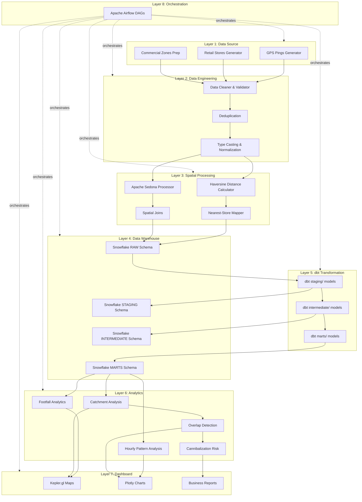
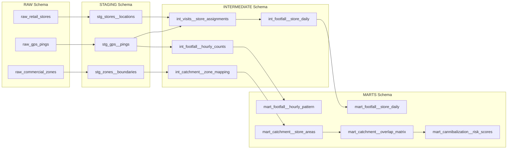

# GeoPulse — System Architecture

> **Version:** 1.0  
> **Date:** 2026-11-15  
> **Status:** Day 2 — Architecture & Data Flow Design  

---

## 1. Architecture Overview

GeoPulse follows an **8-layer architecture** that separates concerns across data ingestion, spatial computation, warehousing, transformation, analytics, and visualization. Each layer has a single responsibility, well-defined inputs/outputs, and a clear owner.

```
Data Sources → Data Engineering → Spatial Processing → Data Warehouse
    → dbt Transformation → Analytics → Dashboard → Orchestration (cross-cutting)
```

---

### Layer 1 — Data Source Layer

| Attribute | Detail |
|---|---|
| **Purpose** | Provide raw input datasets — synthetic GPS mobility pings, retail store locations, and commercial zone boundaries. |
| **Technologies** | Python, Faker/NumPy (for synthetic generation), CSV/GeoJSON files |
| **Inputs** | Configuration parameters (user count, date range, bounding box, store count, zone definitions) |
| **Outputs** | `gps_pings.csv`, `retail_stores.csv`, `commercial_zones.geojson` written to `data/raw/` |
| **Owner** | **Module 1** (Other team member) — GPS & store generation; **Module 2** (You) — commercial zone data prep |

**Key files:**
- `src/data_generation/gps_generator.py`
- `src/data_generation/store_generator.py`
- `src/data_generation/zone_generator.py` *(Module 2 — commercial zoning data prep)*

---

### Layer 2 — Data Engineering Layer

| Attribute | Detail |
|---|---|
| **Purpose** | Clean, validate, and standardize raw datasets. Remove duplicates, handle nulls, enforce coordinate bounds, cast types, and flag anomalies. |
| **Technologies** | Python, Pandas, NumPy, python-dateutil |
| **Inputs** | Raw CSV/GeoJSON files from `data/raw/` |
| **Outputs** | Cleaned files in `data/processed/` — `gps_pings_clean.csv`, `retail_stores_clean.csv`, `commercial_zones_clean.geojson` |
| **Owner** | **Module 1** (Other team member) |

**Key files:**
- `src/data_quality/data_cleaner.py`
- `src/data_quality/validators.py`

---

### Layer 3 — Spatial Processing Layer

| Attribute | Detail |
|---|---|
| **Purpose** | Perform geospatial computations: Haversine distance between GPS pings and stores, nearest-store assignment, spatial joins (point-in-polygon for zone assignment), and buffer/catchment geometry construction. |
| **Technologies** | Haversine, Apache Sedona, GeoPandas, Shapely, PyProj |
| **Inputs** | Cleaned data from `data/processed/` |
| **Outputs** | Spatially enriched datasets in `data/processed/` — `gps_with_nearest_store.csv`, `visits.csv`, `spatial_joins.parquet` |
| **Owner** | **Module 1** (Other team member) |

**Key files:**
- `src/spatial_processing/haversine_calculator.py`
- `src/spatial_processing/nearest_store_mapper.py`
- `src/spatial_processing/sedona_processor.py`
- `src/spatial_processing/spatial_joins.py`

---

### Layer 4 — Data Warehouse Layer (Snowflake)

| Attribute | Detail |
|---|---|
| **Purpose** | Centralized cloud data warehouse storing all datasets across a 4-schema medallion-like architecture. Provides SQL-queryable tables for downstream dbt transformations. |
| **Technologies** | Snowflake, snowflake-connector-python, SQL |
| **Inputs** | Spatially enriched CSV/Parquet files from `data/processed/` |
| **Outputs** | Loaded tables in `GEOPULSE.RAW` schema |
| **Owner** | **Module 1** (Other team member) — Snowflake data integration & loading |

**Key files:**
- `sql/snowflake/ddl/` — Table DDL scripts
- `sql/snowflake/loaders/` — COPY INTO / PUT scripts
- `src/data_generation/snowflake_loader.py` *(or `data_engineering/snowflake_loader.py`)*

---

### Layer 5 — dbt Transformation Layer

| Attribute | Detail |
|---|---|
| **Purpose** | SQL-based transformations inside Snowflake, organized as staging → intermediate → marts models following dbt best practices. |
| **Technologies** | dbt-core, dbt-snowflake, SQL/Jinja |
| **Inputs** | Raw Snowflake tables (`GEOPULSE.RAW.*`) |
| **Outputs** | Business-ready tables in `GEOPULSE.STAGING.*`, `GEOPULSE.INTERMEDIATE.*`, `GEOPULSE.MARTS.*` |
| **Owner** | **Module 2** (You) |

**Key files:**
- `dbt/models/staging/` — Type-casting and renaming
- `dbt/models/intermediate/` — Joins and aggregations
- `dbt/models/marts/` — Final business-ready tables

---

### Layer 6 — Analytics Layer

| Attribute | Detail |
|---|---|
| **Purpose** | Business logic and calculations: store-level footfall counts, hourly footfall patterns, catchment area analysis, geographic overlap detection, and cannibalization risk scoring. |
| **Technologies** | Python, Pandas, NumPy, GeoPandas, Shapely |
| **Inputs** | dbt mart tables (queried from Snowflake or exported as Parquet/CSV) |
| **Outputs** | Analytics result files in `data/analytics/` — `store_footfall.csv`, `hourly_footfall.csv`, `catchment_areas.geojson`, `overlap_matrix.csv`, `cannibalization_scores.csv` |
| **Owner** | **Module 2** (You) |

**Key files:**
- `src/analytics/footfall_analyzer.py`
- `src/analytics/hourly_analyzer.py`
- `src/analytics/catchment_analyzer.py`
- `src/analytics/overlap_detector.py`
- `src/analytics/cannibalization_assessor.py`
- `analytics/` *(root-level module — see Directory Mapping below)*

---

### Layer 7 — Dashboard Layer

| Attribute | Detail |
|---|---|
| **Purpose** | Visual presentation of analytics via interactive geospatial maps and statistical charts. |
| **Technologies** | Kepler.gl, Plotly, HTML/JSON |
| **Inputs** | Analytics result files from `data/analytics/` |
| **Outputs** | Kepler.gl map configs (`dashboard/kepler_config.json`), Plotly HTML charts (`dashboard/charts/`), exported report assets (`reports/`) |
| **Owner** | **Module 2** (You) |

**Key files:**
- `dashboard/kepler_dashboard.py`
- `dashboard/chart_generator.py`
- `dashboard/kepler_config.json`

---

### Layer 8 — Orchestration Layer

| Attribute | Detail |
|---|---|
| **Purpose** | End-to-end pipeline orchestration via Apache Airflow DAGs, scheduling task execution, managing dependencies, retries, and alerting. |
| **Technologies** | Apache Airflow |
| **Inputs** | All pipeline scripts and configurations |
| **Outputs** | Scheduled, monitored pipeline runs with logs |
| **Owner** | **Module 3 — Shared** (both team members) |

**Key files:**
- `airflow/dags/geopulse_pipeline_dag.py`
- `airflow/dags/dbt_dag.py`

---

## 2. Architecture Diagram



---

## 3. Component Diagram

```mermaid
flowchart LR
    subgraph DataGen["Data Generation Components"]
        GG["gps_generator.py"]
        SG["store_generator.py"]
        ZG["zone_generator.py"]
    end

    subgraph DataQuality["Data Quality Components"]
        DC["data_cleaner.py"]
        VL["validators.py"]
    end

    subgraph SpatialProc["Spatial Processing Components"]
        HC["haversine_calculator.py"]
        NSM["nearest_store_mapper.py"]
        SP["sedona_processor.py"]
        SJ["spatial_joins.py"]
    end

    subgraph Warehouse["Snowflake Warehouse"]
        SL["snowflake_loader.py"]
        DDL["DDL Scripts"]
    end

    subgraph DBT["dbt Project"]
        DS["staging models"]
        DI["intermediate models"]
        DM["marts models"]
    end

    subgraph Analytics["Analytics Components"]
        FA["footfall_analyzer.py"]
        HA["hourly_analyzer.py"]
        CA["catchment_analyzer.py"]
        OD["overlap_detector.py"]
        CR["cannibalization_assessor.py"]
    end

    subgraph Dashboard["Dashboard Components"]
        KD["kepler_dashboard.py"]
        CG["chart_generator.py"]
    end

    GG -->|gps_pings.csv| DC
    SG -->|retail_stores.csv| DC
    ZG -->|commercial_zones.geojson| DC

    DC --> VL
    VL -->|cleaned data| HC
    VL -->|cleaned data| SP

    HC --> NSM
    SP --> SJ

    NSM -->|enriched CSV| SL
    SJ -->|spatial parquet| SL

    SL --> DDL
    DDL -->|RAW tables| DS
    DS -->|STAGING tables| DI
    DI -->|INTERMEDIATE tables| DM

    DM -->|MARTS tables| FA
    DM -->|MARTS tables| HA
    DM -->|MARTS tables| CA

    CA --> OD
    OD --> CR

    FA --> KD
    FA --> CG
    HA --> CG
    CA --> KD
    OD --> CG
    CR --> CG
```



---

## 4. Integration Points & Module Handoffs

### Layer-to-Layer Integration

| From → To | Integration Mechanism | Data Format | Handoff Point |
|---|---|---|---|
| L1 → L2 | File system (`data/raw/`) | CSV, GeoJSON | Raw files written to `data/raw/` |
| L2 → L3 | File system (`data/processed/`) | Cleaned CSV, GeoJSON | Cleaned files in `data/processed/` |
| L3 → L4 | Snowflake connector / `COPY INTO` | CSV, Parquet → Snowflake tables | Files staged and loaded into `GEOPULSE.RAW` |
| L4 → L5 | dbt source references | Snowflake SQL | dbt `source()` macro referencing RAW tables |
| L5 → L6 | Snowflake queries / file export | SQL result sets or Parquet exports | Mart tables queried by analytics scripts |
| L6 → L7 | File system (`data/analytics/`) | CSV, GeoJSON, JSON | Analytics outputs consumed by dashboard builders |
| L8 → All | Airflow task orchestration | PythonOperator / BashOperator calls | DAG tasks invoke each layer's scripts |

### Module 1 → Module 2 Handoff (Critical Interface)

The primary handoff between Module 1 (Data Engineering & Spatial Processing) and Module 2 (Analytics & Visualization) occurs at **two points**:

1. **File-level handoff:** Spatially enriched files in `data/processed/` are the physical artifacts that Module 1 produces and Module 2 can consume directly for local development/testing.

2. **Warehouse-level handoff:** Once data is loaded into Snowflake `RAW` schema, Module 2's dbt models take over. The `RAW` schema tables are the **contract interface** — their column names and types are the agreed-upon schema.

> [!IMPORTANT]
> Both team members must agree on the RAW table schemas before writing dbt models or analytics code. See [Inter-Module Interfaces in module_design.md](file:///c:/Users/yash/geoplus/documentation/module_design.md) for the exact column definitions.

---

## 5. Snowflake Schema Approach

GeoPulse uses a **4-schema medallion-like architecture** inside a single Snowflake database (`GEOPULSE`):

```
RAW → STAGING → INTERMEDIATE → MARTS
```

### Schema Details

| Schema | Purpose | Naming Convention | Example Tables |
|---|---|---|---|
| **RAW** | Landing zone for ingested data. Exact copies of source files, no transformation. All columns `VARCHAR` or raw types. | `raw_<source>` | `raw_gps_pings`, `raw_retail_stores`, `raw_commercial_zones` |
| **STAGING** | Cleaned, type-cast, renamed versions of RAW tables. 1:1 mapping with RAW. dbt handles this. | `stg_<source>__<entity>` | `stg_gps__pings`, `stg_stores__locations`, `stg_zones__boundaries` |
| **INTERMEDIATE** | Joined, aggregated, and enriched datasets. Business logic begins here. Many-to-many relationships resolved. | `int_<domain>__<description>` | `int_visits__store_assignments`, `int_footfall__hourly_counts`, `int_catchment__zone_mapping` |
| **MARTS** | Final business-ready tables optimized for analytics and dashboards. Denormalized for query performance. | `mart_<domain>__<entity>` | `mart_footfall__store_daily`, `mart_footfall__hourly_pattern`, `mart_catchment__store_areas`, `mart_cannibalization__risk_scores` |

### Data Flow Through Schemas



---

## 6. dbt Model Organization

```
dbt/
├── dbt_project.yml
├── packages.yml
├── profiles.yml                  # Snowflake connection (gitignored)
├── models/
│   ├── staging/
│   │   ├── _staging__sources.yml        # Source definitions (RAW tables)
│   │   ├── _staging__models.yml         # Model docs & tests
│   │   ├── stg_gps__pings.sql           # Type-cast, rename, deduplicate
│   │   ├── stg_stores__locations.sql    # Type-cast, validate coordinates
│   │   └── stg_zones__boundaries.sql    # Parse GeoJSON, type-cast
│   ├── intermediate/
│   │   ├── _intermediate__models.yml
│   │   ├── int_visits__store_assignments.sql   # Join pings ↔ stores
│   │   ├── int_footfall__hourly_counts.sql     # Aggregate by hour
│   │   ├── int_footfall__store_daily.sql       # Aggregate by store × day
│   │   └── int_catchment__zone_mapping.sql     # Map stores to zones
│   └── marts/
│       ├── _marts__models.yml
│       ├── mart_footfall__store_daily.sql       # Final store footfall
│       ├── mart_footfall__hourly_pattern.sql    # Hourly patterns
│       ├── mart_catchment__store_areas.sql      # Catchment per store
│       ├── mart_catchment__overlap_matrix.sql   # Pairwise overlap
│       └── mart_cannibalization__risk_scores.sql # Risk scores
├── macros/
│   └── haversine.sql             # Reusable Haversine macro
├── seeds/
│   └── commercial_zone_lookup.csv
└── tests/
    └── assert_positive_footfall.sql
```

### Model Responsibilities

| Layer | What It Does | Example Transformation |
|---|---|---|
| **staging/** | Clean and type-cast raw data. One model per source table. No joins. | `CAST(latitude AS FLOAT)`, `TO_TIMESTAMP(ping_timestamp)`, dedup via `ROW_NUMBER()` |
| **intermediate/** | Aggregate and join across staging models. Business logic begins. | Join `stg_gps__pings` with `stg_stores__locations` on nearest-store ID; `GROUP BY store_id, DATE(visit_time)` |
| **marts/** | Business-ready, denormalized analytics tables. Optimized for dashboards. | Final footfall counts with store metadata, catchment areas with overlap percentages, cannibalization risk scores |

---

## 7. Directory Mapping — Reconciling Scaffold vs. Proposed Structure

The existing scaffold uses `src/` sub-modules, while the project proposal references root-level `analytics/` and `data_engineering/` directories. **Both are kept** with the following mapping:

| Scaffold Path (`src/`) | Root-Level Path | Purpose | Owner |
|---|---|---|---|
| `src/data_generation/` | `data_engineering/generators/` | Synthetic data generators | Module 1 |
| `src/data_quality/` | `data_engineering/quality/` | Data cleaning & validation | Module 1 |
| `src/spatial_processing/` | `data_engineering/spatial/` | Haversine, Sedona, spatial joins | Module 1 |
| `src/analytics/` | `analytics/` | Business analytics & calculations | Module 2 |

> [!NOTE]
> The `src/` modules are the **primary working directories**. The root-level `analytics/` and `data_engineering/` directories, if created, serve as thin wrappers or alternative entry points that import from `src/`. This avoids code duplication.

---

## 8. Security & Configuration

- **Snowflake credentials:** Stored in `.env` file (gitignored), loaded via `python-dotenv`.
- **dbt profiles:** `dbt/profiles.yml` is gitignored; template provided as `dbt/profiles.yml.example`.
- **Airflow connections:** Configured via Airflow Variables/Connections UI, not hardcoded.
- **No PII:** All data is synthetically generated — no real user data.
